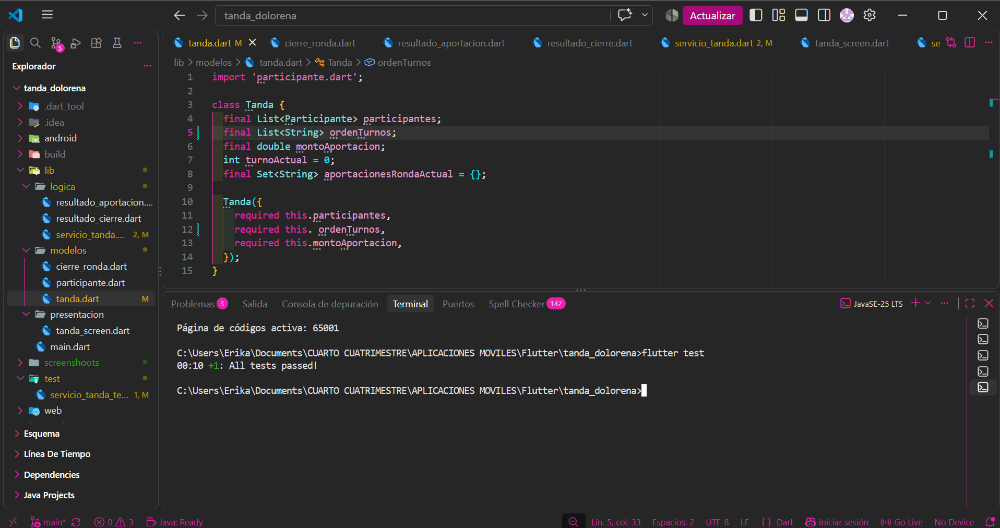
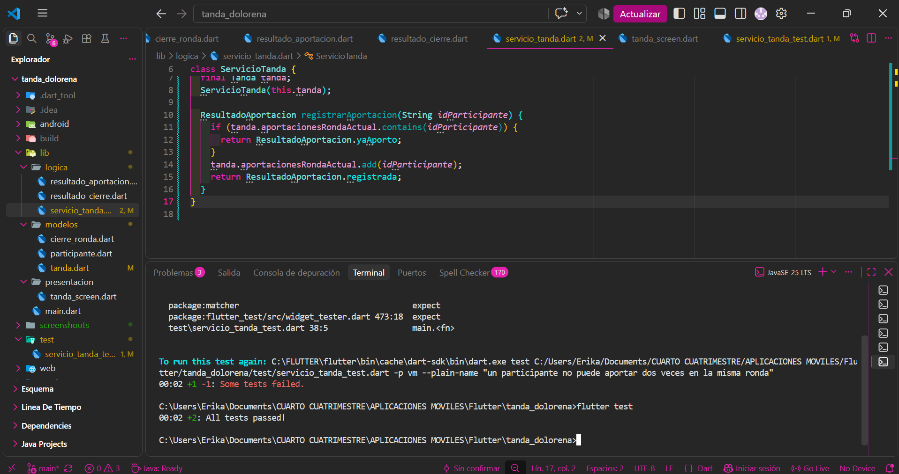
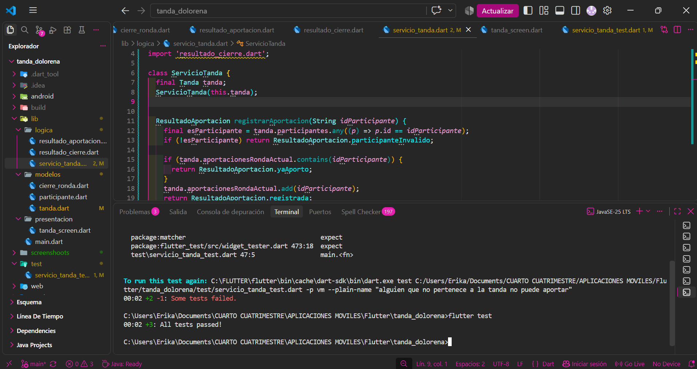
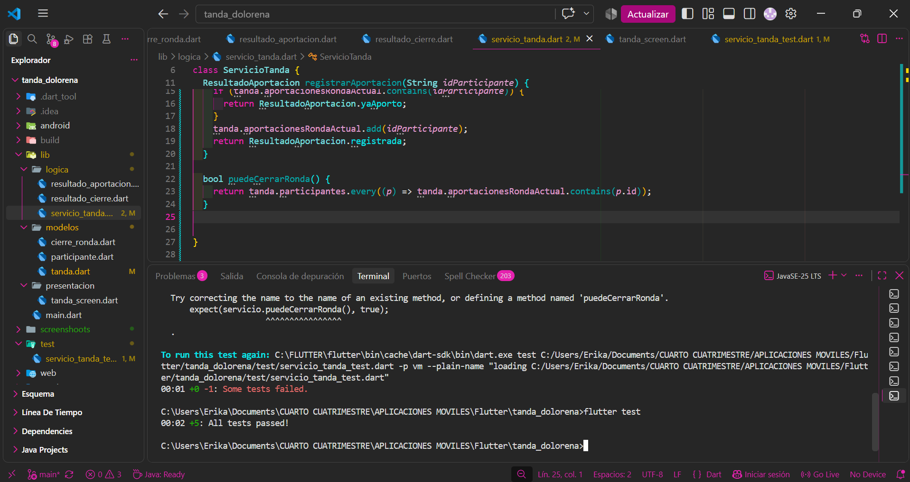
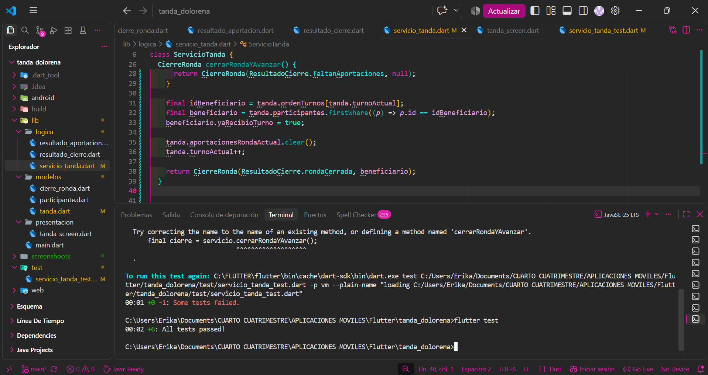
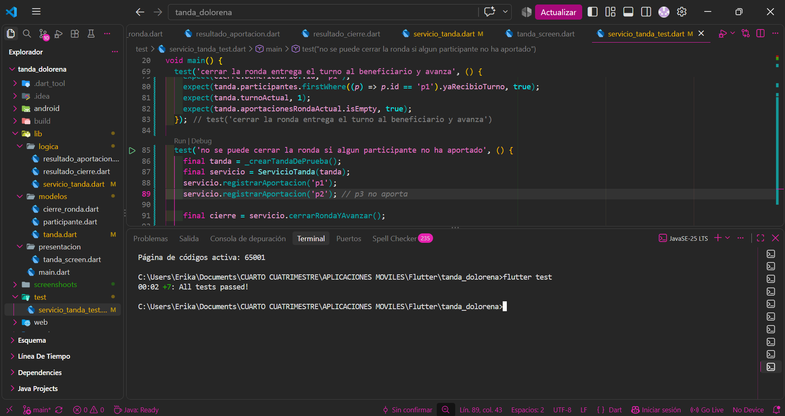
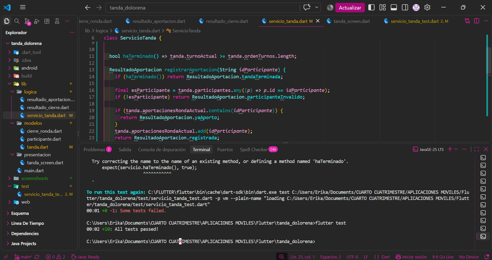
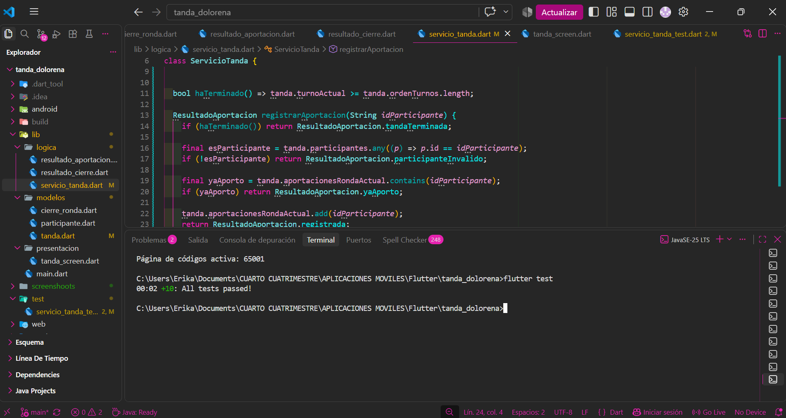
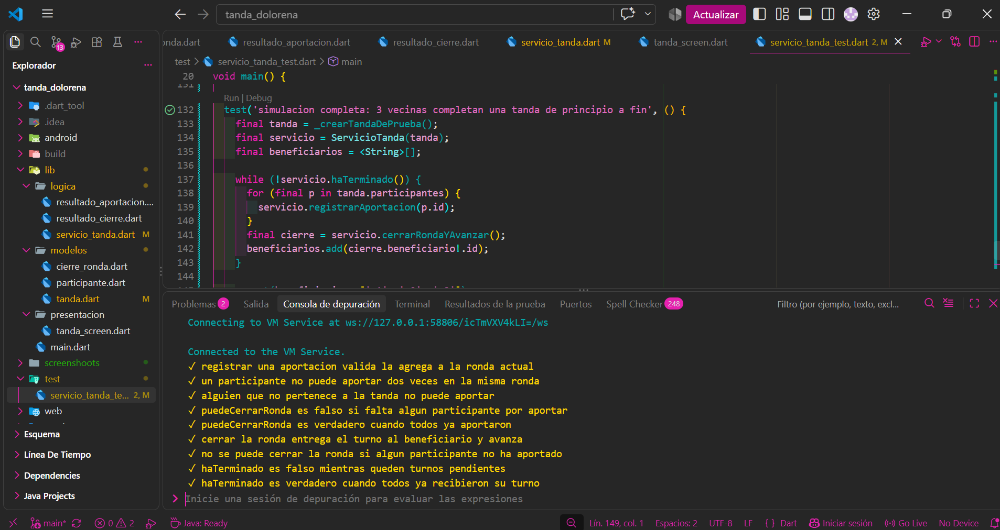
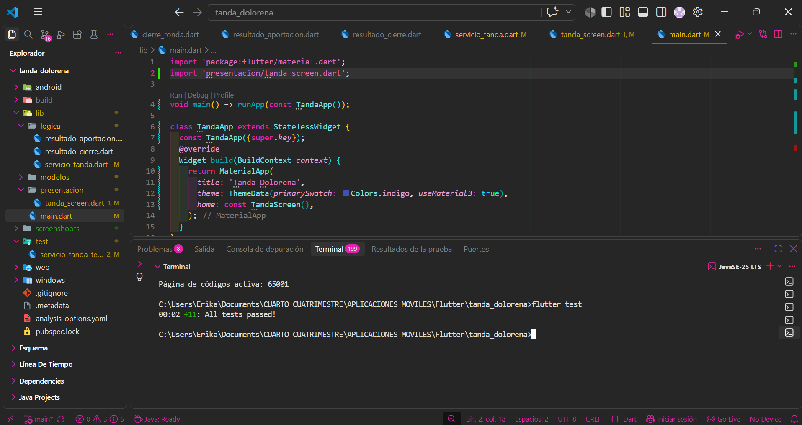

# tanda_dolorena

## Ronda 1. Registrar una aportación válida

## Ronda 1. Registrar una aportación válida

## RONDA 2 — Rechazar una aportación repetida

## RONDA 3 — Rechazar aportaciones de quien no es participante

## RONDA 4 — Detectar cuándo todos ya aportaron

## RONDA 5 — Cerrar la ronda y entregar el turno

## RONDA 6 — No cerrar la ronda si faltan aportaciones

## RONDA 7 — Detectar cuándo la tanda ha terminado

## RONDA 8 — Refactor: nombrar las condiciones como reglas de negocio

## Prueba de integración: una tanda completa de principio a fin

## La interfaz gráfica animada

